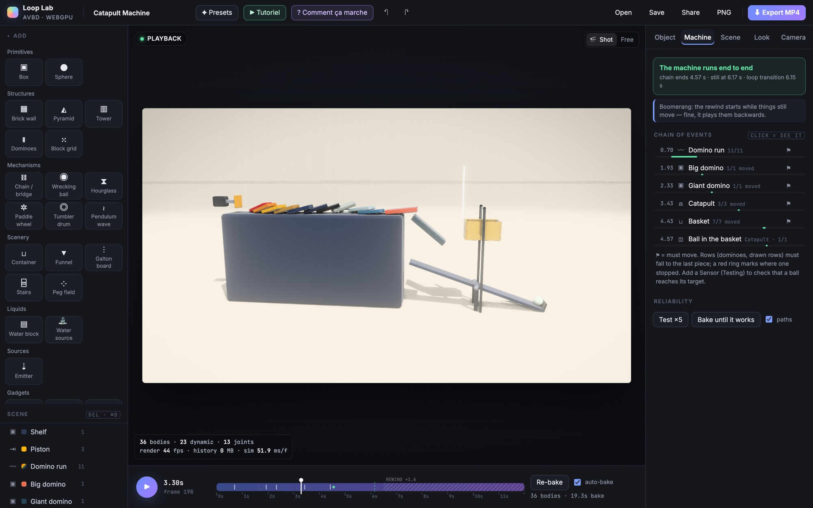
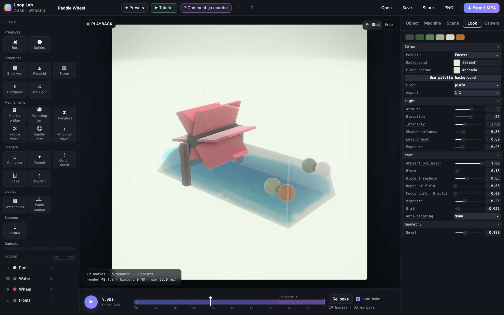

# Loop Lab

Loop Lab is a browser application for building physics scenes and chain-reaction machines, simulating them on the
GPU with **Augmented Vertex Block Descent** (AVBD) and exporting them as **seamless looping MP4** clips of up to
30 seconds. It also includes an MLS-MPM liquid solver, an interactive course on how a physics engine works and a
guided tutorial of the editor.

**Live version: [drschizzo.github.io/avbd](https://drschizzo.github.io/avbd/)** (requires a WebGPU browser).





## Getting started

Requirements: Node.js and a WebGPU browser (a recent desktop Chrome or Edge with hardware acceleration).

```bash
npm install
npm run dev            # development server
npm run build          # type check + production build
npm test               # unit tests (Vitest)
npm run check:unused   # unused locals, outside the vendored engine
```

Every push to `main` runs the tests, builds the app and publishes it to GitHub Pages
(`.github/workflows/pages.yml`). The build reads its base path from `BASE_PATH` (`/` by default).

## Features

### Scene editor

- **Parts palette**: primitives (box, sphere), structures (brick wall, pyramid, tower, dominoes, block grid),
  mechanisms (chain / bridge, wrecking ball, hourglass, paddle wheel, tumbler drum, pendulum wave), scenery
  (container, funnel, Galton board, stairs, peg field), sources (emitter), liquids (water block, water source),
  gadgets and test sensors.
- **Inspector** with five tabs: *Object* (parameters, look, physics, kinematic motion), *Machine* (diagnosis of
  the last bake), *Scene* (clip, loop transition, solver and liquid settings), *Look* (palette, light,
  post-processing) and *Camera* (exported shot and its motion).
- **Gizmo** combining move handles and rotation rings (Q / W / E, Shift snaps), click picking in edit and
  playback modes, undo / redo, autosave in local storage, JSON open / save and share links.
- **Baking**: the scene is simulated at a fixed step after each physics edit (auto-bake) and playback starts
  while frames are still being computed.
- **22 presets**, from single effects (Pyramid Topple, Cube Rain, Shattered Wall, Rope Bridge, Galton Board,
  Hourglass Flip, Pendulum Wave…) to liquids (Dam Break, Fill & Drain, Paddle Wheel, Cannonball) and complete
  machines (Catapult Machine, Marble Run, Grand Machine, and the empty Machine Workshop).

### Chain-reaction machines

| Tool | Usage |
| --- | --- |
| **Drop-in placement** | A palette tile, a paste or a saved gadget follows the cursor and rests on the surface under it. Click drops it, ⇧ snaps to a 0.25 m grid, right-click / Esc cancels. |
| **✎ Draw** (D) | Drag in the viewport to draw a path filled with a **domino run**, a **marble row**, a **block row**, a **rail** (floor and side walls), a **track** (flat strip) or a **guide wall**. Blue dots are control points (Del removes one); *Reshape* replaces the path with a line, arc, S-curve, zigzag, circle or helix. |
| **Work plane** (P) | XY / ZY / XZ: drawing and placing land on the plane and the gizmo stays on it. `[` `]` move it by 0.25 m, ⊡ faces it. |
| **Selection and groups** | ⇧-click adds or removes, ⌘A selects all, ⌘G / ⇧⌘G group and ungroup; ⌥-click selects one member of a group. |
| **Copy / paste** | ⌘C / ⌘X / ⌘V (the clipboard is kept across scenes), ⌘D duplicates, *Repeat…* creates a row or a ring of copies. |
| **Ports** | Orange rings at the ends of ramps, rails, rollers and cups: moved parts snap end to end (⌥ moves freely). |
| **⤓ Drop** (End) / **⌖** (F) | Lower the selection onto the surface below / frame it in the free camera. |
| **My gadgets** | *Save as gadget…* stores the selection in the palette. |

Gadgets: **Seesaw** (also a catapult), **Ramp**, **Hammer** (hinged pendulum, optionally held by a timed catch),
**Free wheel**, **Piston** (kinematic pusher, used to start a machine at a given time), **Cup**, **Rollers**
(powered conveyor), **Sensor** (test zone, invisible in the render). The **Wrecking ball** can start *latched* on a
bar resting on a loose prop, so the machine itself releases it. Hinges are made of two spherical joints, as the
engine has no revolute joint.

**Machine tab** (`src/sim/analysis.ts`). After each bake the recorded poses are sampled (about 30 per second) and
every object is judged: when it was first set in motion (moved by a quarter of its size or turned by 20°), whether a
row fell to its last piece (a red ring marks where it stopped), when each sensor was reached, and when the last
motion ended compared with the start of the loop transition. Objects marked ○ are decor. *Test ×5* bakes the
machine five times with sub-millimetre perturbations and reports how often each step succeeds; *Bake until it
works* keeps the first fully successful run; *Solo* bakes only the selection.

**Follow camera** (`src/sim/follow.ts`). The camera motion *follow* uses the machine check samples to track where
things move: each object pulls the camera with a weight based on its squared speed and on how recently it started,
the path is smoothed and looks slightly ahead. It keeps the angle of the shot camera and never goes farther than the
wide shot. *Camera follows* (Object tab) excludes an object.

### Seamless loops

The last frame of a clip must match the first. Each scene selects a transition:

- **reassemble**: bodies return to their initial pose (staggered, along an arc); spawned bodies disappear.
- **shrink**: everything shrinks out at the end and grows back at the start.
- **sink**: the ground becomes permeable and everything sinks through the floor.
- **boomerang**: the clip plays forward at real speed, slows down into an apex, then rewinds faster (*Rewind
  speed*) and lands on frame 0. Only the forward part is simulated (`src/sim/loopTime.ts`). Suited to destruction
  scenes.
- **continuous**: for steady processes (drum, mixer, stream, hourglass). The clip is simulated twice: a warm-up
  pass, then the recorded pass starting where the warm-up ended. During the last `outro` seconds each body blends
  onto the trajectory of an interchangeable twin from the warm-up (same shape, size and finish;
  `src/sim/loopMatch.ts`), so the final frame shows the same picture as frame 0. Emitted bodies are recycled.
  Baking takes twice as long.
- **none**: for purely kinematic scenes that are already periodic, such as the Pendulum Wave.

Kinematic motions (spin, swing, slide, gate) and camera motions are periodic over the clip.

### Liquids

`src/fluid/` runs an MLS-MPM liquid on the same GPU device as the rigid bodies:

| File | Role |
| --- | --- |
| `fluidBuild.ts` | Seeds particles (8 per grid cell) from *Water block* and *Water source* entities and fits the simulation box. |
| `fluidSolver.ts` | MLS-MPM in raw WGSL (APIC transfer, Tait pressure, viscosity, fixed-point atomics). Static scenery is rasterised once into a collider map, moving bodies every frame. Two-way coupling: dynamic bodies receive the momentum the liquid loses against them every substep, so they float, sink or get carried away. |
| `fluidRender.ts` | Screen-space surface: sphere impostors, thickness, bilateral depth smoothing, refraction, Beer–Lambert absorption, Fresnel reflection, plus a proxy for shadows. |

The liquid history uses 8 bytes per particle per frame and stays on the GPU. Liquids follow the loop transitions;
*Settle pre-roll* (Scene → Liquid) relaxes resting pools before frame 0.

### Export

`src/export/video.ts` renders the baked simulation offline, frame by frame, with optional 2× supersampling, and
encodes it to H.264 MP4 with WebCodecs. Resolution, frame rate, bitrate and number of repetitions are configurable.
The top bar also offers a PNG snapshot.

### Course: « Anatomie d'un moteur physique »

The **? Comment ça marche** button opens a guided course (in French, about 25 minutes) on how a physics engine
works. It combines narration with draggable values in code, prediction questions, hands-on pauses with missions and
a workshop of coding challenges.

| File | Role |
| --- | --- |
| `src/course/tour.ts` | Course content on a single timeline, organised in modules and chapters. |
| `src/course/mini.ts` | A 2D rigid-body engine that runs the same scene with no solver, sequential impulses (PGS), a plain penalty (VBD) or full AVBD, and records every iteration. |
| `src/course/diagrams*.ts` | Animated canvas diagrams; those about the solver plot the output of `mini.ts`. |
| `src/course/simcache.ts` | Records the diagram simulations once and replays them within a per-frame budget. |
| `src/course/scenes.ts` | Short 3D scenes simulated by the GPU engine; changing a solver setting re-bakes them. |
| `src/course/lab.ts` | Challenges where the learner writes a part of the engine in JavaScript, compared frame by frame with a reference. |

The two engines use some names for different quantities (the mini engine's `beta` is a penalty growth factor, the
GPU engine's a penalty value). `DOC_KEYS` in `tour.ts` lists the parameters that mean the same thing in both.

### Guided tutorial

The **▶ Tutoriel** button (offered on the first visit) opens a guided tour of the editor (in French, about
15 minutes). The editor stays live while a floating card points at the relevant part of the interface. Part 1
presents the interface on the *Catapult Machine* preset; part 2 builds a small machine (ramp, ball, drawn domino run,
pyramid) on *Machine Workshop*, then covers diagnosis, loop settings and export.

| File | Role |
| --- | --- |
| `src/tutorial/steps.ts` | Steps: target element (`data-tut` attributes), task, completion test read from the app state, hints and a « Faire pour moi » action. |
| `src/tutorial/index.ts` | Card, spotlight and 3D markers; saves progress and offers to restore the previous scene on exit. |

## Architecture

Data flows in one direction: **`SceneDoc`** (plain serialisable document, `src/scene/doc.ts`) → **`buildScene()`**
(pure function producing a flat list of bodies, joints and motions, `src/scene/build.ts`) → **`Baker`** (GPU
simulation) → **`BakeResult`** → renderers, machine check and export. Everything before the GPU step is
deterministic and covered by unit tests.

| Module | Responsibility |
| --- | --- |
| `src/app.ts` | Composition root and command façade (`commit`, `select`, `bake`, `undo`…) used by the UI, the course and the tutorial. |
| `src/core/` | `history` (undo by document snapshots), `persistence` (autosave, share links), `events` (typed `AppEvent`), `context` (settings layers that the course and tutorial push and pop). |
| `src/scene/` | Document, entity catalogue, scene builder, paths, gadgets, palettes, presets, document migration. |
| `src/sim/baker.ts` | Fixed-step bake recorded on the GPU into a history buffer of 16 bytes per body per frame (float32 position and a 10:10:10:2 quaternion), read directly by the vertex shaders. While the page is visible, the bake runs in slices paced on rendered frames so the preview stays fluid. |
| `src/sim/bakeController.ts` | When to bake, streaming to the renderers, loop matching, machine check, robustness trials. |
| `src/sim/bakePlan.ts`, `poseCodec.ts` | History memory plan; the pose format, with its CPU and WGSL implementations side by side. |
| `src/sim/batchedCompute.ts` | Groups the compute dispatches of a frame into one command buffer. |
| `src/render/` | `stage` (renderer, studio environment, soft shadows, GTAO, bloom, depth of field, anti-aliasing), `bodies` (one instanced draw per shape and material class, rounded boxes with a constant bevel), `shotCamera`, `threeInternals` (the only place that accesses three.js private state). |
| `src/edit/` | `viewport` (gizmos, picking, overlays), `selection`, `tools` (placement, drawing, ports, clipboard, gadgets). |
| `src/ui/` | `ui.ts` assembles the page from `inspector` and `tabs/*` (one module per tab), `leftPanel`, `overlays`, `timeline`, `dialogs` and `shortcuts`. |
| `src/util/` | `storage` (every local storage key), `dom`, `num`. |

**Adding a part** means adding one entry to `ENTITY_DEFS` (`src/scene/entities.ts` or `src/scene/gadgets.ts`): a
parameter schema (which generates the Object tab), a builder in the part's local frame, and optional behaviours
(`hang`, `marker`, `spawnsLate`, `chain`, `liquid`, `onParamChange`, `ports`). No other module depends on specific
entity types. `test/entities.test.ts` checks that every entry builds finite bodies and valid joints.

**Tests** (`test/`) include a golden master of the scene built from every preset and unit tests of the pure core:
pose codec, boomerang time mapping, kinematic motions, document migration, machine check, history, selection,
settings layers and the bake memory plan.

## Physics engine

`src/engine/` contains the GPU AVBD solver of [jure/webphysics](https://github.com/jure/webphysics) (MIT), with
the following differences from upstream:

- kinematic bodies that move along a prescribed velocity, so contacts carry other bodies correctly;
- breakable joints (`fracture` force threshold);
- fixed joints that keep the relative orientation the two bodies had when the joint was created;
- `stepFixed()` for deterministic stepping, `setGravity()`, `setDrag()` (implicit linear and angular damping) and
  `dispose()`;
- sphere contact arms kept along the contact normal, so rolling spheres stay on surfaces;
- brute-force pair decoding that is robust to `sqrt` rounding, and `clearScene()` uploading its cleared buffers in
  full;
- a body solve that accumulates the local 6×6 system as 3×3 blocks (Schur complement), runs one 32-lane workgroup
  per body (`AvbdStateStage.wideBodySolve`), uses one kernel instance per graph colour and a local-diagonal inertia
  variant.

The solver is not bitwise deterministic from run to run (atomic accumulation order), which is why machines are
evaluated with repeated trials.

## Design notes

Recommended settings and observations for building scenes with this engine:

- Contacts need `beta` ≈ 1e4 and joints ≈ 1e5 with `alpha` 0.95; thin bodies need 4 substeps.
- Contacts are inelastic. A rail made of short pieces must not present an upward step at a seam: each piece overlaps
  the next one forward and sits slightly lower. A marble on a curved rail settles to about 1.5 m/s.
- A domino cannot push a body much heavier than itself. Grow dominoes in steps of about 2× mass; at 3× or more the
  lighter one slides under the heavier one.
- A catapult varies by about ±10 % between runs: catch the projectile with a backboard and a wide basket.
- A drawn domino row can end up to one spacing before the end of its path: place what it must hit from the last
  domino built (`buildPath`).
- For *continuous* loops, place the seam where the process is calm, use few colour classes and keep every body in
  play.
- The Galton board uses air drag (`physics.drag`) so that beads lose their sideways momentum and form a binomial
  distribution.

## Development

In development builds the browser console exposes helpers, among them:

- `app`, the application instance;
- `machine(key)`, which bakes a preset and summarises its machine check;
- `soloN([...])`, `traj3(name, nth, every)`, `hist(frame)`;
- `bench(key)`, `benchAll([...])`, `loadTest(key, paced?)` for performance;
- `seam(key)`, `evalPreset(key)`, `matchStats()` for loop quality;
- `shots(key, times)`, `shot(name, t)`, `view(...)`, which save frames to `.debug/`;
- `courseSelfTest()`, `course.go(t)`, `tutorial.go(i)`, `tutorial.list()`.

Setting `app.baker.batcher.profile = true` records per-kernel GPU timestamps.

## Credits and licence

Engine code © 2026 Jure Triglav, MIT licence (`src/engine/LICENSE.md`).
AVBD: Giles, Diaz, Yuksel, *Augmented Vertex Block Descent*, SIGGRAPH 2025.
